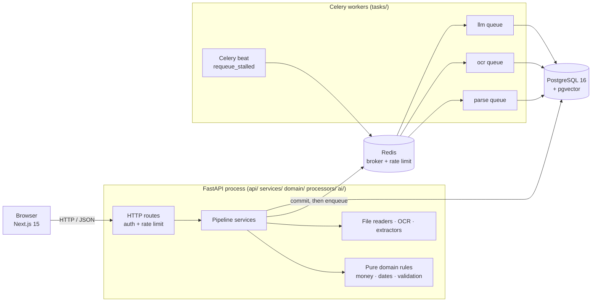
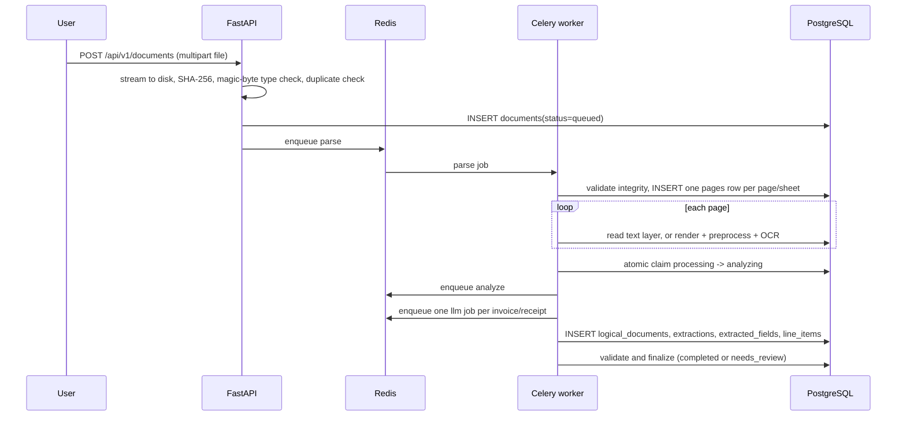

# Architecture

## Style: modular monolith + background workers

One Python codebase (`backend/app`) runs as an **API process** (FastAPI) and as **worker processes** (Celery). They share the same modules and
the same PostgreSQL database; Redis is only the message broker (and the shared rate-limit counter).
*Why not microservices:* the load is heavy background work behind a light API, which a pool of workers solves directly; microservices would add
network failure modes and deployment cost without a benefit at this scale. Clean layers keep a later split possible.

Request path and the background hand-off (the API never does OCR or extraction inline):

The API and the workers are the same image/codebase (`backend/Dockerfile`) started with different commands in `docker-compose.yml`; Redis is only a broker and rate-limit counter, never a source of truth.

## Layers (dependencies point downward only)

| Layer | Folder | Rule |
|---|---|---|
| HTTP | `api/` | thin: validate input, check role, call a service, shape the response |
| Services | `services/` | business operations and the pipeline stages; own transactions |
| Capabilities | `processors/`, `ai/` | file readers, OCR, extractors, grounding, embeddings |
| Domain | `domain/` | **pure** functions: money, dates, validation rules, matching. No database, no HTTP → trivially unit-testable |
| Persistence | `db/` | SQLAlchemy models; Alembic migrations in `alembic/` |
| Background | `tasks/` | Celery tasks are thin wrappers: open session → call stage → commit → enqueue next stage |

## Processing workflow

1. **Upload** (API, synchronous and cheap): stream to a temp file while hashing → detect real type by content → duplicate check by SHA-256 →
   move to content-addressed storage → row `documents(status=queued)` → **commit** → enqueue.
2. **start** (`parse` queue): open the file with the real parser (corrupt/encrypted/too big → `rejected` with a reason), create one `pages` row per page/sheet.
3. **pages** (`parse`, or `ocr` for scans): each page is its own job. A PDF page with a text layer is extracted directly; one without is re-queued to the
   `ocr` queue (render → preprocess/deskew → Tesseract → words with boxes and confidences). Spreadsheets are parsed by one job per file.
   Each page stores text, method, OCR confidence and word boxes.
4. **claim** — the last page to finish performs `UPDATE documents SET status='analyzing' WHERE status='processing'`; exactly one worker wins and enqueues step 5.
5. **analyze**: classify pages (invoice / receipt / other) and **split into logical documents**; reconcile with any previous split; compute embeddings for search.
6. **extract** (`llm` queue, one job per invoice/receipt): extractor → **grounding** → confidence → persist new *extraction version* → deterministic **validation**.
7. **finalize**: when no logical document is pending, atomically set `completed` or `needs_review`.
8. **Review** (humans): corrections are stored separately; validation re-runs immediately; approve clears the flag.
9. **Verification** (on demand): compare two documents (below).

### Why "page-level + claims" instead of a Celery chord/group
A job that waits for other jobs ties up a worker slot and deadlocks when the pool is small; it also loses its place if the worker dies. Instead every stage is
a small **idempotent** function and hand-over happens through an atomic database update. If any message is lost, the **reaper** (`requeue_stalled`, run by Celery beat) finds documents
that have not made progress for `STALLED_AFTER_MINUTES` and simply enqueues their current stage again; idempotency makes duplicates harmless. This was tested with a real `SIGKILL` of the worker.

### Failure handling
| Failure | Behaviour |
|---|---|
| Network/LLM timeout, rate limit (HTTP 429/5xx), OCR timeout | `TransientProcessingError` → retry with exponential backoff + jitter (max 5), then recorded as failed |
| Corrupt page, unreadable image, bad credentials (HTTP 400/403) | `PermanentProcessingError` → page/extraction marked failed with the reason; the rest of the document continues |
| Unexpected exception (bug) | `on_failure` handler records it in the database, so a document never hangs silently |
| Worker killed | broker message may stay invisible; reaper re-queues after the stall window |
| Damaged-but-repairable PDF | processed, but the document is always `needs_review` |
| Reprocess | `resume` retries failed work; `reextract` makes a new extraction version and **keeps corrections** |

## Extraction design

* **Evidence on every value:** `raw_text` (verbatim), `page`, `bbox`, `source` (extracted | inferred), `confidence`, `grounded`.
* **Grounding** (`ai/grounding.py`): a value is accepted only if its quoted text appears in the page text and the normalised value agrees with the quote
  (e.g. the amount parsed from `Tax (10%)  $2.55` is 2.55, not 102.55). Otherwise the value is **dropped** and flagged; the rejected value is kept in `extractions.raw_json` for audit.
* **Confidence** is *computed*, not self-reported by an LLM: OCR word confidence (or 0.97 for a text layer) × format validity × grounding; inferred values are capped at 0.6; overall = mean of the 5 required fields.
* **Prompt-injection defence** (LLM path): document text is passed only inside delimited data blocks (delimiters inside the text are neutralised), the system prompt declares it untrusted, output is forced into a strict schema and re-validated, every value must pass grounding, and **deterministic code — never the model — makes decisions** (validation, approval).
* **Long invoices** are extracted in page chunks and merged (identity fields from the first chunk that has them, totals from the last, line items concatenated and de-duplicated).
* **Providers** sit behind one interface: `heuristic` (offline) and `gemini` (free tier). Adding another is one class.

## Cross-document verification

1. Build comparable *records* from each document's effective values (corrections applied), each field remembering its source (file, page, bbox or sheet+cell).
2. **Match records:** normalised invoice number first (case, punctuation, leading zeros ignored); otherwise supplier similarity ≥ 0.6 **and** equal total.
3. **Compare fields** with explicit rules — amounts within tolerance (default 0.01), dates exact, currency exact, names by normalised similarity (match ≥ 0.85, uncertain ≥ 0.6), line items greedily by amount.
4. **Verdicts:** `match`, `mismatch`, `uncertain`, `missing_in_left/right`, `not_comparable` (nothing to compare, e.g. summary spreadsheet vs line items — reported, never counted as a discrepancy).
5. Everything is stored (`comparisons`, `comparison_items`) with the rule text, so a result can be audited later. No LLM is involved in pass/fail.

## Spreadsheets
No standard layout exists, so: find the header row within the first 30 rows → map header names to canonical fields via a synonym table (e.g. "Vendor", "Supplier Name" → supplier;
a bare "Amount" is resolved by context) → group rows into invoices (one row per invoice, or several rows sharing an invoice number with line-item columns) → keep the cell reference of every value.
Formulas without a cached value (file not saved by Excel) are reported as a warning. `.xlsm` macros are rejected.

## Search
* **Keyword:** `websearch_to_tsquery` over a GIN-indexed `to_tsvector('english', text)`; headlines are produced only for the top hits and marked with `[[[ ]]]` (never HTML).
* **Semantic:** cosine distance on an HNSW-indexed `vector(384)` per page chunk.
* **Hybrid:** reciprocal rank fusion of both lists. Structured filters (supplier, date range, total range, currency, status, review flag) apply to all modes via the logical-document page ranges.

## Key decisions (and trade-offs)

| Decision | Alternative | Trade-off |
|---|---|---|
| PostgreSQL for everything (relational + FTS + vectors) | separate search/vector DBs | one system to run and back up; less scalable than specialised engines (fine for thousands–millions of pages) |
| Content-addressed file storage behind an interface | store by name / S3 now | immune to path tricks and de-duplicates for free; local disk only today (swap-in S3/MinIO later) |
| Synchronous SQLAlchemy | async | one style for API and workers, simpler to learn/debug; slightly lower raw API concurrency |
| Denormalised summary columns on `logical_documents` | join to fields on every query | fast filtering/sorting; must be refreshed (done on every extraction/correction) |
| Corrections layered on extractions | edit values in place | reprocessing can never destroy human work; slightly more complex reads |
| `Decimal`/`NUMERIC` for all money | float | exact arithmetic; the only acceptable choice for finance |
| Polling for progress | WebSockets/SSE | simplest and robust; slightly more requests |
| JWT in `localStorage` | httpOnly cookie | simple for a separate-origin SPA; exposes the token to XSS (mitigated by never rendering untrusted HTML) — see SECURITY.md |

## Performance notes
Page-level jobs keep memory flat (measured); the LLM is never given a whole large file; only pages already classified as invoices/receipts are sent to it; the free-tier rate limit is shared across workers through Redis;
all list endpoints are paginated; indexes cover the filter and sort columns. Measured numbers: [TESTING_REPORT](TESTING_REPORT.md).
