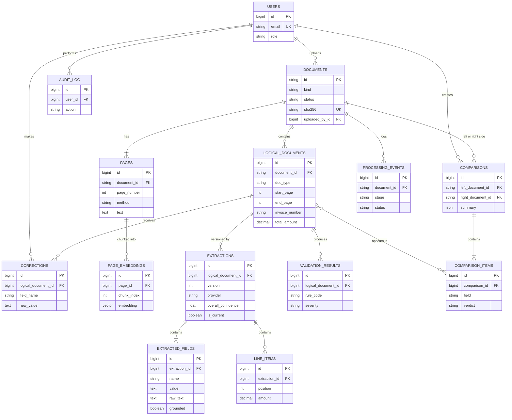

# Database schema

*The table listings below are generated by `scripts/gen_docs.py` from the SQLAlchemy models, and the Alembic migration `backend/alembic/versions/0001_initial_schema.py` is verified against them by `alembic check` (see the test-suite).*

PostgreSQL 16 with the `vector` (pgvector) extension.

## Design notes

- **Money** is `NUMERIC(18,4)` and `Decimal` in Python. Never floats.
- **Extractions are versioned.** Re-extracting creates a new `extractions` row (`is_current`); old ones stay.
- **Corrections are separate rows.** The effective value of a field is the latest correction, else the current extraction. Reprocessing therefore cannot destroy a reviewer's work.
- **A file can hold many invoices.** `documents` (the file) → `logical_documents` (each invoice/receipt/other, with a page range).
- `logical_documents` also stores *denormalised effective values* (supplier, number, date, total, currency, review flags) for fast filtering; they are refreshed after every extraction or correction.
- **Search indexes:** a GIN expression index `ix_pages_fts` on `to_tsvector('english', pages.text)` and an HNSW cosine index `ix_page_embeddings_hnsw` on `page_embeddings.embedding` (384 dimensions).
- **Idempotency & recovery:** stage hand-off uses atomic `UPDATE ... WHERE status = X` claims on `documents.status`; `documents.updated_at` lets the reaper find stalled work.
- Deleting a document cascades to everything derived from it.

Cardinality notes: one uploaded file (`documents`) contains one or more logical documents; each logical document has many extraction
versions and at most one *current* version; corrections and validation results belong to the logical document, not to a version, so
re-extraction cannot erase them. Full column lists follow.

## Tables

### `audit_log`

| Column | Type | Null | Notes |
|---|---|---|---|
| `id` | BIGINT | no | PK |
| `user_id` | BIGINT | yes |  |
| `action` | VARCHAR(50) | no |  |
| `entity_type` | VARCHAR(30) | yes |  |
| `entity_id` | VARCHAR(64) | yes |  |
| `detail` | JSON | yes |  |
| `ip` | VARCHAR(64) | yes |  |
| `created_at` | DATETIME | no |  |

Indexes: `ix_audit_log_action`, `ix_audit_log_created_at`

### `comparison_items`

| Column | Type | Null | Notes |
|---|---|---|---|
| `id` | BIGINT | no | PK |
| `comparison_id` | BIGINT | no | FK → comparisons (on delete cascade) |
| `pair_index` | INTEGER | no |  |
| `left_logical_id` | BIGINT | yes |  |
| `right_logical_id` | BIGINT | yes |  |
| `field` | VARCHAR(40) | no |  |
| `left_value` | TEXT | yes |  |
| `right_value` | TEXT | yes |  |
| `left_source` | JSON | yes |  |
| `right_source` | JSON | yes |  |
| `verdict` | VARCHAR(20) | no |  |
| `rule` | TEXT | yes |  |

Indexes: `ix_comparison_items_comparison_id`

### `comparisons`

| Column | Type | Null | Notes |
|---|---|---|---|
| `id` | BIGINT | no | PK |
| `left_document_id` | CHAR(32) | yes | FK → documents (on delete set null) |
| `right_document_id` | CHAR(32) | yes | FK → documents (on delete set null) |
| `summary` | JSON | yes |  |
| `created_by_id` | BIGINT | yes | FK → users (on delete set null) |
| `created_at` | DATETIME | no |  |

### `corrections`

| Column | Type | Null | Notes |
|---|---|---|---|
| `id` | BIGINT | no | PK |
| `logical_document_id` | BIGINT | no | FK → logical_documents (on delete cascade) |
| `target_type` | VARCHAR(12) | no |  |
| `field_name` | VARCHAR(40) | no |  |
| `line_item_position` | INTEGER | yes |  |
| `old_value` | TEXT | yes |  |
| `new_value` | TEXT | yes |  |
| `reason` | TEXT | yes |  |
| `user_id` | BIGINT | yes | FK → users (on delete set null) |
| `created_at` | DATETIME | no |  |

Indexes: `ix_corrections_logical_document_id`

### `documents`

| Column | Type | Null | Notes |
|---|---|---|---|
| `id` | CHAR(32) | no | PK |
| `original_filename` | VARCHAR(500) | no |  |
| `kind` | VARCHAR(10) | no |  |
| `mime_type` | VARCHAR(100) | no |  |
| `size_bytes` | BIGINT | no |  |
| `sha256` | VARCHAR(64) | no | unique |
| `storage_path` | VARCHAR(500) | no |  |
| `status` | VARCHAR(20) | no |  |
| `page_count` | INTEGER | no |  |
| `pages_done` | INTEGER | no |  |
| `error_message` | TEXT | yes |  |
| `uploaded_by_id` | BIGINT | yes | FK → users (on delete set null) |
| `created_at` | DATETIME | no |  |
| `updated_at` | DATETIME | no |  |

Indexes: `ix_documents_sha256`, `ix_documents_status`

### `extracted_fields`

| Column | Type | Null | Notes |
|---|---|---|---|
| `id` | BIGINT | no | PK |
| `extraction_id` | BIGINT | no | FK → extractions (on delete cascade) |
| `name` | VARCHAR(40) | no |  |
| `value` | TEXT | yes |  |
| `raw_text` | TEXT | yes |  |
| `page` | INTEGER | yes |  |
| `bbox` | JSON | yes |  |
| `source` | VARCHAR(10) | no |  |
| `confidence` | FLOAT | no |  |
| `grounded` | BOOLEAN | no |  |

Indexes: `ix_extracted_fields_extraction_id`

Unique constraints: (extraction_id, name)

### `extractions`

| Column | Type | Null | Notes |
|---|---|---|---|
| `id` | BIGINT | no | PK |
| `logical_document_id` | BIGINT | no | FK → logical_documents (on delete cascade) |
| `version` | INTEGER | no |  |
| `provider` | VARCHAR(30) | no |  |
| `model` | VARCHAR(100) | yes |  |
| `prompt_version` | VARCHAR(20) | no |  |
| `raw_json` | JSON | yes |  |
| `overall_confidence` | FLOAT | no |  |
| `is_current` | BOOLEAN | no |  |
| `duration_ms` | INTEGER | yes |  |
| `usage` | JSON | yes |  |
| `created_at` | DATETIME | no |  |

Indexes: `ix_extractions_logical_document_id`

Unique constraints: (logical_document_id, version)

### `line_items`

| Column | Type | Null | Notes |
|---|---|---|---|
| `id` | BIGINT | no | PK |
| `extraction_id` | BIGINT | no | FK → extractions (on delete cascade) |
| `position` | INTEGER | no |  |
| `description` | TEXT | yes |  |
| `quantity` | NUMERIC(18, 4) | yes |  |
| `unit_price` | NUMERIC(18, 4) | yes |  |
| `amount` | NUMERIC(18, 4) | yes |  |
| `page` | INTEGER | yes |  |
| `raw_text` | TEXT | yes |  |
| `bbox` | JSON | yes |  |
| `confidence` | FLOAT | no |  |

Indexes: `ix_line_items_extraction_id`

Unique constraints: (extraction_id, position)

### `logical_documents`

| Column | Type | Null | Notes |
|---|---|---|---|
| `id` | BIGINT | no | PK |
| `document_id` | CHAR(32) | no | FK → documents (on delete cascade) |
| `position` | INTEGER | no |  |
| `doc_type` | VARCHAR(12) | no |  |
| `start_page` | INTEGER | no |  |
| `end_page` | INTEGER | no |  |
| `classification_score` | FLOAT | no |  |
| `source` | VARCHAR(12) | no |  |
| `sheet_ref` | JSON | yes |  |
| `extraction_status` | VARCHAR(10) | no |  |
| `error` | TEXT | yes |  |
| `invoice_number` | VARCHAR(200) | yes |  |
| `supplier_name` | VARCHAR(300) | yes |  |
| `customer_name` | VARCHAR(300) | yes |  |
| `invoice_date` | DATE | yes |  |
| `total_amount` | NUMERIC(18, 4) | yes |  |
| `currency` | VARCHAR(8) | yes |  |
| `needs_review` | BOOLEAN | no |  |
| `review_status` | VARCHAR(10) | no |  |
| `validation_status` | VARCHAR(10) | no |  |
| `created_at` | DATETIME | no |  |

Indexes: `ix_logical_documents_document_id`, `ix_logical_documents_invoice_date`, `ix_logical_documents_invoice_number`, `ix_logical_documents_needs_review`, `ix_logical_supplier_invoice`

Unique constraints: (document_id, position)

### `page_embeddings`

| Column | Type | Null | Notes |
|---|---|---|---|
| `id` | BIGINT | no | PK |
| `document_id` | CHAR(32) | no | FK → documents (on delete cascade) |
| `page_id` | BIGINT | no | FK → pages (on delete cascade) |
| `page_number` | INTEGER | no |  |
| `chunk_index` | INTEGER | no |  |
| `content` | TEXT | no |  |
| `embedding` | vector(384) | no |  |

Indexes: `ix_page_embeddings_document_id`, `ix_page_embeddings_hnsw`, `ix_page_embeddings_page_id`

### `pages`

| Column | Type | Null | Notes |
|---|---|---|---|
| `id` | BIGINT | no | PK |
| `document_id` | CHAR(32) | no | FK → documents (on delete cascade) |
| `page_number` | INTEGER | no |  |
| `label` | VARCHAR(255) | yes |  |
| `status` | VARCHAR(10) | no |  |
| `method` | VARCHAR(12) | yes |  |
| `text` | TEXT | no |  |
| `char_count` | INTEGER | no |  |
| `ocr_confidence` | FLOAT | yes |  |
| `width` | FLOAT | yes |  |
| `height` | FLOAT | yes |  |
| `layout` | JSON | yes |  |
| `error` | TEXT | yes |  |
| `updated_at` | DATETIME | no |  |

Indexes: `ix_pages_document_id`

Unique constraints: (document_id, page_number)

### `processing_events`

| Column | Type | Null | Notes |
|---|---|---|---|
| `id` | BIGINT | no | PK |
| `document_id` | CHAR(32) | no | FK → documents (on delete cascade) |
| `logical_document_id` | BIGINT | yes |  |
| `stage` | VARCHAR(30) | no |  |
| `status` | VARCHAR(12) | no |  |
| `message` | TEXT | yes |  |
| `detail` | JSON | yes |  |
| `duration_ms` | INTEGER | yes |  |
| `created_at` | DATETIME | no |  |

Indexes: `ix_processing_events_created_at`, `ix_processing_events_document_id`

### `users`

| Column | Type | Null | Notes |
|---|---|---|---|
| `id` | BIGINT | no | PK |
| `email` | VARCHAR(320) | no | unique |
| `password_hash` | VARCHAR(255) | no |  |
| `role` | VARCHAR(20) | no |  |
| `is_active` | BOOLEAN | no |  |
| `created_at` | DATETIME | no |  |

Indexes: `ix_users_email`

### `validation_results`

| Column | Type | Null | Notes |
|---|---|---|---|
| `id` | BIGINT | no | PK |
| `logical_document_id` | BIGINT | no | FK → logical_documents (on delete cascade) |
| `rule_code` | VARCHAR(50) | no |  |
| `severity` | VARCHAR(10) | no |  |
| `message` | TEXT | no |  |
| `field` | VARCHAR(40) | yes |  |
| `expected` | TEXT | yes |  |
| `actual` | TEXT | yes |  |
| `created_at` | DATETIME | no |  |

Indexes: `ix_validation_results_logical_document_id`
