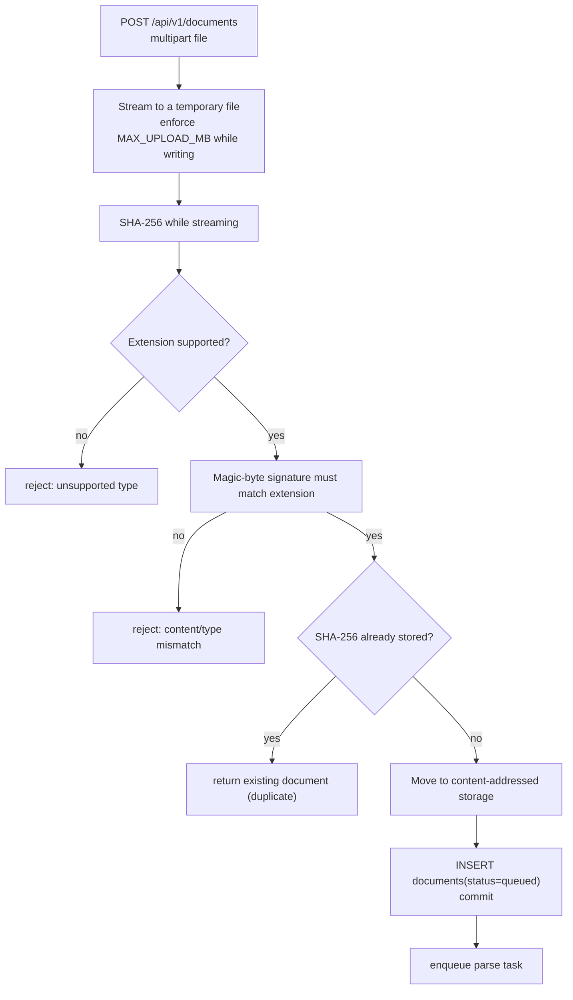

# Processing pipelines

How a file becomes structured invoice data: intake, parsing, extraction, validation, review. This document covers the four input
families in the specification — **PDF, images, Excel, and CSV** — plus the shared stages that run after parsing.

Everything below is implemented in `backend/app/`; the code map at the end points at the exact modules.

## 1. Common intake (all formats)

Rules that apply to every format:

| Check | Behaviour | Code |
|---|---|---|
| Extension allow-list | `.pdf .png .jpg .jpeg .tif .tiff .xlsx .xls .csv` | `processors/files.py` |
| Content signature | PDF `%PDF-`, PNG, JPEG, TIFF, ZIP (XLSX), OLE (XLS), or printable text (CSV) | `processors/files.py::_signature` |
| Empty file | rejected | `detect_kind` |
| Size | `MAX_UPLOAD_MB` (default 200) enforced while streaming | `services/ingest.py` |
| Duplicate | same SHA-256 returns the existing document id, upload discarded | `services/ingest.py` |
| Integrity | file is opened with its real parser before any page is created | `validate_integrity` |
| Page/sheet cap | `MAX_PAGES_PER_DOCUMENT` (default 3000) | `_check_pdf`, `_check_image` |
| Image pixels | `MAX_IMAGE_PIXELS` (default 60,000,000) | `_check_image` |
| ZIP expansion | `MAX_ZIP_UNCOMPRESSED_MB` (default 600), ratio and path checks, `.xlsm` rejected | `check_zip_safety` |

A rejected file never reaches the parse stage: `documents.status = rejected` and `error_message` contains the reason.

## 2. Format dispatch

`services/pipeline.py::start_document` validates the file, creates one `pages` row per **PDF page**, **image frame**, or **sheet**,
and sets `documents.status = processing`. The parse stage then dispatches:

| Input | `documents.kind` | Unit of work | Parser |
|---|---|---|---|
| PDF | `pdf` | page | PyMuPDF text layer; Tesseract fallback |
| PNG / JPEG | `image` | frame | Pillow + Tesseract |
| TIFF (multi-page) | `image` | frame | Pillow + Tesseract |
| XLSX | `xlsx` | sheet | openpyxl (values + formulas) |
| XLS | `xls` | sheet | xlrd |
| CSV | `csv` | file (one sheet) | `csv` module |

## 3. PDF pipeline

### 3.1 Digital PDF (has a text layer)

1. `read_pdf_text_layer()` opens the file with PyMuPDF and reads `page.get_text("words")`.
2. Words are converted to `Word(x0, y0, x1, y1, text, confidence=1.0)` and joined into reading-order text by
   `layout.words_to_text()`.
3. If the page has at least `scanned_text_threshold` (default 25) non-space characters, it is stored with
   `method = text_layer`; confidence is reported as 0.97 per field by the scoring stage.
4. `pages.layout` stores the word boxes as JSON, so every extracted value can be traced to a rectangle on the page.

### 3.2 Scanned PDF (no usable text layer)

1. `process_page()` receives `None` from the text-layer reader and returns `needs_ocr`; the task is re-enqueued on the `ocr` queue.
2. `render_pdf_page()` rasterises the page at `OCR_DPI` (default 200) with PyMuPDF.
3. `processors/imaging.py::preprocess()`:
   - convert to grayscale;
   - `ImageOps.autocontrast(..., cutoff=1)`;
   - estimate skew by projection-profile variance over ±5° in 0.5° steps; rotate when |angle| ≥ 0.5°;
   - optional median filter (`OCR_DENOISE`) and Otsu binarisation (`OCR_BINARIZE`).
4. Tesseract runs with `--oem 1 --psm 6` (`processors/ocr.py`), English by default.
5. Word boxes come back in deskewed coordinates and are mapped back to the original page with `unrotate_point()`;
   per-word confidence and the mean OCR confidence are stored.
6. If OCR produces no text, the page is stored with `method = empty` (not an error); validation later reports the missing fields.

### 3.3 Multi-page and bundles

- One job per page keeps memory flat: a 1,000-page PDF is never loaded as a whole.
- The last finishing page performs an atomic `UPDATE documents SET status='analyzing' WHERE status='processing'`.
  Exactly one worker wins and enqueues `analyze_document`.
- `processors/classify.py` labels each page `invoice`, `receipt`, or `other`, detects "Page X of Y", and splits
  consecutive pages into `logical_documents` (one invoice may span pages; one file may contain hundreds of invoices).
- Each logical document is extracted independently; totals are taken from the last page chunk, identity fields from the first.

### 3.4 PDF failures

| Condition | Result |
|---|---|
| Encrypted / password-protected | rejected at intake (`PDF is password-protected`) |
| Truncated but repairable | processed; `is_repaired` warning forces `needs_review` |
| Unreadable page | page marked failed; other pages continue |
| More pages than the cap | rejected at intake |

## 4. Image pipeline (PNG, JPEG, TIFF)

1. `load_image_frame()` opens with Pillow, rejects images above `MAX_IMAGE_PIXELS`, seeks to the requested frame
   (TIFF pages), calls `ImageOps.exif_transpose` so phone photos are upright, and converts to RGB.
2. The image goes through the same `preprocess()` and Tesseract path as a scanned PDF page.
3. `scale = 1.0` because image coordinates are already pixels; boxes are stored in pixel coordinates.
4. Multi-frame TIFF is treated as a multi-page document; each frame is a separate page/job.
5. Corrupt data, decompression bombs, and unsupported modes fail with `PermanentProcessingError` on that frame.

## 5. Excel pipeline (`.xlsx`, `.xls`)

Spreadsheets have no standard layout, so the pipeline is: **find the header → map columns → group rows into records → keep cell references**.

### 5.1 Reading

| Format | Library | Notes |
|---|---|---|
| `.xlsx` | `openpyxl` in `read_only=True, data_only=True` | values only; a second workbook with `data_only=False` detects formulas that have no cached value |
| `.xls` | `xlrd` | dates converted with `xldate_as_datetime`; empty/blank cells become `None` |
| both | `MAX_SHEET_ROWS` (default 200,000) | sheets are truncated with a warning, never silently |

XLSX intake checks the ZIP central directory before parsing: total uncompressed size, compression ratio, unsafe paths,
and `vbaproject.bin` (macro-enabled workbooks are rejected).

Each sheet becomes one `pages` row (`method = table`) whose text is the TSV rendering of the sheet. The first 100 rows are
also stored in `pages.layout` for the UI.

### 5.2 Header detection and mapping

- `find_header()` scans the first 30 rows and chooses the row with the richest mapping (at least 3 known columns and one anchor:
  invoice number, total, or line amount).
- `map_header_row()` normalises header text (lower-case, punctuation removed) and maps synonyms, for example:
  - `invoice_number`: *invoice number, invoice no, invoice #, inv no, bill number, document number…*
  - `supplier_name`: *supplier, vendor, seller, from, company…*
  - `total_amount`: *total, grand total, amount due, gross amount…*
  - `tax`: *tax, vat, gst, sales tax…*
- Decorated headers are accepted when they start with a known synonym followed by a space, e.g. `Invoice Date (DD/MM/YYYY)`.
- A bare `Amount` column is resolved by context: a line amount when a description column exists, otherwise the invoice total.
- Values are parsed with the same `parse_amount` / `parse_date` used by the domain layer; currency codes are normalised.

### 5.3 Row grouping

- **Summary layout** (one row per invoice): every non-empty row becomes a `SheetRecord`.
- **Line-item layout** (description + quantity/unit price/line amount): rows sharing the same invoice number are grouped into one
  invoice; a new invoice number starts a new record.
- Totals rows (`Total`, `Subtotal`, `Grand Total`) are skipped as records.
- Every field keeps its cell reference (`Sheet!C5`), and every line item keeps its line-amount cell reference.
- The record is stored as a `logical_documents` row with `source = spreadsheet` and a `sheet_ref` JSON document containing
  the fields, their cell refs, the line items, and whether the sheet has line-item columns.
- Extraction for these records is deterministic: `_scored_from_sheet()` reads the cell values back with confidence 0.98 and
  `grounded = true`; no LLM call is made. Validation then applies the same financial rules.

### 5.4 Excel edge cases

| Case | Behaviour |
|---|---|
| Formula without cached value | warning stored on the page: *formula cell(s) have no cached value* |
| Macro-enabled `.xlsm` | rejected (not in the allow-list; `vbaProject.bin` also rejected) |
| No recognisable header | warning `no invoice-like table was recognised`; no logical document |
| Multiple sheets | each sheet is a page; each recognised record becomes a logical document |
| Corrupt ZIP/OLE | rejected at intake with the parser error |

## 6. CSV pipeline

1. `decode_text_bytes()` reads the whole file and detects encoding:
   - UTF-16 only when a BOM is present (avoids false positives on legacy 8-bit text);
   - otherwise UTF-8 with BOM, then cp1252, then latin-1.
2. `csv.Sniffer` detects the delimiter from the first 8 KB among `, ; \t |`; on failure the Excel dialect is used.
3. Rows are parsed with the standard `csv` module, stripped, and empty strings become `None`.
4. `MAX_SHEET_ROWS` is enforced with a warning; the sheet is named `csv`.
5. The same header mapping and row grouping as Excel then apply. Encoding and truncation warnings are stored on the page and in
   `processing_events`.
6. Non-text content, binary signatures, or an undetectable encoding are rejected.

## 7. After parsing: extraction, validation, review

All formats converge on the same post-processing:

1. **Classify / split** (PDF and images) or **record grouping** (spreadsheets).
2. **Extract**: heuristic rules (`LLM_PROVIDER=heuristic`, default, offline) or Gemini (`LLM_PROVIDER=gemini`).
   Long invoices are processed in page chunks and merged.
3. **Ground**: every field must be found in the page text (`ai/grounding.py`). Ungrounded values are dropped, kept in
   `extractions.raw_json` for audit, and force review. Inferred values are labelled and capped at 0.6 confidence.
4. **Score**: OCR word confidence × format validity × grounding; overall confidence is the mean of the required fields.
5. **Persist**: a new `extractions` version, its `extracted_fields` and `line_items` (with page, bbox/sheet+cell, raw text).
6. **Validate** (`domain/validation.py`, deterministic `Decimal`): required fields, line math, subtotal, tax, total,
   currency, dates, duplicates. Each issue has a stable code and severity.
7. **Finalize**: `completed` when there are no errors and nothing uncertain, otherwise `needs_review`.
8. **Review**: corrections are stored in separate `corrections` rows, validation re-runs immediately, and approval clears the flag.

## 8. Configuration reference

| Variable | Default | Used by |
|---|---|---|
| `MAX_UPLOAD_MB` | 200 | intake streaming |
| `MAX_PAGES_PER_DOCUMENT` | 3000 | PDF/image frame count |
| `MAX_IMAGE_PIXELS` | 60,000,000 | Pillow decompression guard |
| `MAX_SHEET_ROWS` | 200,000 | XLSX/XLS/CSV rows per sheet |
| `MAX_ZIP_UNCOMPRESSED_MB` | 600 | XLSX zip-bomb guard |
| `OCR_DPI` | 200 | PDF rasterisation |
| `OCR_LANG` | `eng` | Tesseract language |
| `OCR_DESKEW` | `true` | projection-profile deskew |
| `OCR_DENOISE` / `OCR_BINARIZE` | `false` / `false` | optional preprocessing |
| `SCANNED_TEXT_THRESHOLD` | 25 | characters below which a PDF page goes to OCR |
| `LLM_PROVIDER` | `heuristic` | `heuristic` or `gemini` |
| `LLM_PAGES_PER_CALL` | 6 | chunk size for LLM extraction |
| `EMBEDDER` | `hashing` | `hashing` or `sentence-transformers` |

## 9. Code map

| Stage | File |
|---|---|
| Content detection, magic bytes, ZIP safety, integrity | `backend/app/processors/files.py` |
| Upload streaming, hashing, duplicate check | `backend/app/services/ingest.py` |
| PDF text layer, rasterisation, OCR page | `backend/app/processors/pdfpages.py` |
| Image loading, EXIF transpose, deskew, autocontrast | `backend/app/processors/imaging.py` |
| Tesseract wrapper, word boxes, confidence | `backend/app/processors/ocr.py` |
| Reading order, word→text, snippet location | `backend/app/processors/layout.py` |
| XLSX/XLS/CSV reading, header mapping, record grouping | `backend/app/processors/spreadsheet.py` |
| Page classification and bundle splitting | `backend/app/processors/classify.py` |
| Stage orchestration, claims, finalization | `backend/app/services/pipeline.py` |
| Extraction, grounding, confidence | `backend/app/services/extraction.py`, `backend/app/ai/` |
| Deterministic financial rules | `backend/app/domain/validation.py` |

## 10. Tests that exercise these paths

| Path | Tests |
|---|---|
| PDF digital, scanned, multi-page, encrypted, corrupt, bundles | `tests/test_pipeline_api.py`, `tests/test_ai_and_processors.py` |
| PNG, JPEG, multi-page TIFF | `tests/test_pipeline_api.py` |
| XLSX summary + line layouts, multi-sheet, XLS, CSV encodings/delimiters/formulas | `tests/test_ai_and_processors.py`, `tests/test_pipeline_api.py` |
| OCR clean/rotated/noisy/JPEG, deskew ablation | `tests/test_ai_and_processors.py`, `scripts/evaluate.py` |
| Grounding, prompt injection, hallucination | `tests/test_review_and_failures.py`, `tests/test_ai_and_processors.py` |
| Validation rules | `tests/test_domain.py` |

Measured results for these paths are in [TESTING_REPORT.md](TESTING_REPORT.md) and [EVALUATION_REPORT.md](EVALUATION_REPORT.md).